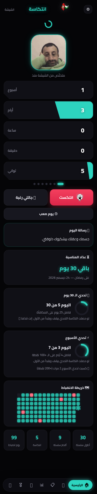
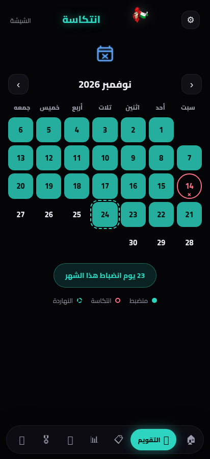
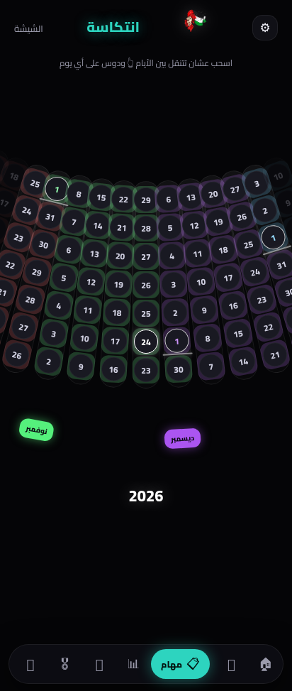
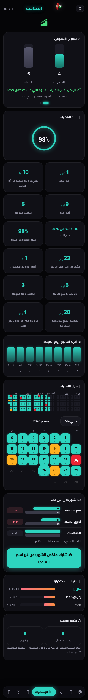
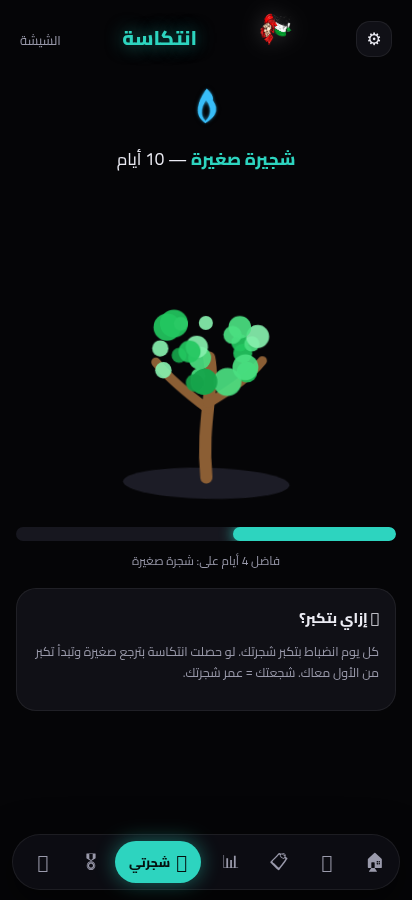
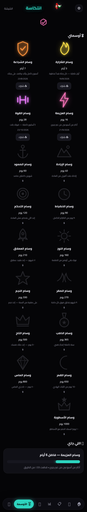
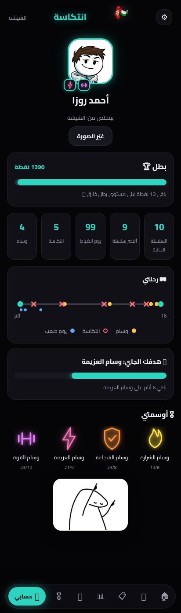
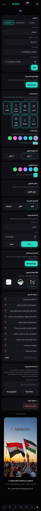

# انتكاسة — Intikasa

تطبيق أندرويد شخصي يساعدك تبعد عن عادة وحشة وتتابع تقدمك يوم بيوم: عداد اكتفاء حي، تحديات، XP وأوسمة، شجرة بتكبر معاك، ونصايح دينية ونفسية. كل حاجة شغالة **أوفلاين بالكامل** وبياناتك بتفضل على موبايلك بس.

A personal Android app to help you quit a bad habit and track your progress: a live clean-time counter, challenges, XP and medals, a tree that grows with you, and religious & psychological guidance. **Fully offline** — all data stays on your phone.

---

## لقطات الشاشة — Screenshots

<p align="center">
  
  
  
  
</p>
<p align="center">
  
  
  
  
</p>

---

## المميزات — Features

### العداد — The Counter
- عداد اكتفاء حي بالثواني والدقائق والساعات والأيام، مضبوط من التوقيت المخزن كل ثانية (مفيش أي انحراف).
- Live clean-time counter (seconds → days), recomputed from the stored timestamp every tick — zero drift.
- إعادة حساب فورية عند أي تعديل أو تسجيل انتكاسة.

### اليوميات والتحديات — Daily Tools
- **مهام اليوم**: قائمة مهام يومية بتتصفر كل يوم، ونقاط XP على كل مهمة.
- **التحدي الأسبوعي**: 7 أيام اكتفاء ورا بعض = ‎+100 XP، وبيبدأ من تاني لوحده.
- **ملاحظة المزاج** وزر **يوم صعب** اللي بيأثر على التحديات والملصقات.
- Daily tasks, a weekly 7-day challenge (+100 XP, auto-restart), mood notes, and a "hard day" button.

### التقدم — Progress
- **شجرة الاكتفاء**: شجرة بتكبر وبتتفتح مع كل مرحلة تقدم.
- **17 وسام** لحد 1000 يوم، آخرهم **وسام الأسطورة**، مع تهنئة خاصة عند ثالث وسام.
- **XP**: (أيام الاكتفاء × 10) + (الأوسمة × 50) + (التحديات × 100).
- **إحصائيات**: خريطة حرارية للشهر، سجل انضباط، ألوان شهور مميزة في التقويم.
- A growth tree, 17 neon medals up to 1000 days (final: Legend Medal), XP system, monthly heatmap and discipline record.

### النصايح — Guidance
- محتوى **ديني** ومحتوى **نفسي** منظم، متاح أوفلاين بالكامل.
- Religious and psychological guidance content, fully offline.

### الخصوصية والأمان — Privacy & Security
- **مفيش أي اتصال بالإنترنت**: مفيش تحليلات، مفيش إشعارات، مفيش خوادم — بياناتك محلية 100%.
- **قفل برقم سري (PIN)** عند فتح التطبيق.
- **نسخة احتياطية محلية** بتتحفظ في ملفات التنزيلات بتاعتك.
- أيقونة بديلة للتطبيق لو حابب خصوصية زيادة.
- 100% local data, PIN lock, local backup to your Downloads folder, and an optional alternate app icon.

### التصميم — Design
- واجهة **عربية مصري** RTL بالكامل.
- ثيم **AMOLED أسود + نيون**، حواف مدورة، وأنيميشن خفيف وحيوي في كل حتة.
- صورك الشخصية بتتبدل فوق العداد مع كل فتحة تطبيق.
- Full Egyptian-Arabic RTL UI, AMOLED black + neon theme, rounded corners, lively animations, and personal photos rotating above the counter.

---

## التثبيت — Install

1. نزّل أحدث APK من صفحة [Releases](../../releases).
2. افتحه على موبايلك (هيحتاج إذن تثبيت من مصادر خارجية لأنه مش على المتجر).
3. حط الرقم السري بتاعك وابدأ رحلتك.

1. Download the latest APK from [Releases](../../releases).
2. Install it (allow installs from unknown sources).
3. Set your PIN and start.

---

## التقنية — Tech Notes

- **Android WebView** بواجهة HTML/CSS/JS محلية بالكامل (مفيش سيرفر ولا إنترنت).
- Kotlin للطبقة الأصلية: الرقم السري، الويدجت، والنسخ الاحتياطي.
- `minSdk 24` — `target 34` — أندرويد موبايل بس.
- الموقع بتاع البناء: Gradle 8.x + AGP 8.2.2.
- Local HTML/CSS/JS UI inside an Android WebView (no server, no internet), Kotlin for the native layer (PIN lock, widget, backup). `minSdk 24`, `target 34`, phones only.

### التوقيع — Signing

الـ APK بيتبني بمفتاح توقيع محلي. `app/intikasa.keystore` و `keystore.properties` **مش موجودين في الريبو** (`gitignore`).

The release APK is signed with a local keystore. `app/intikasa.keystore` and `keystore.properties` are **not in this repo** (gitignored). To build locally:

```bash
cp keystore.properties.template keystore.properties
# املاه بالبيانات الصح / fill in the real values
gradle assembleRelease
```

---

<div dir="rtl" align="center">
صُنع بحب في مصر 🇪🇬
</div>
