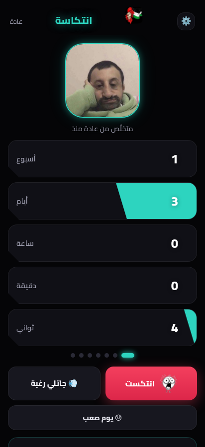
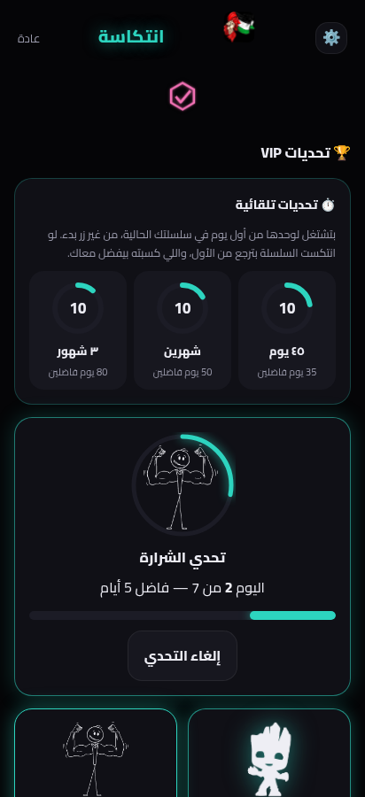
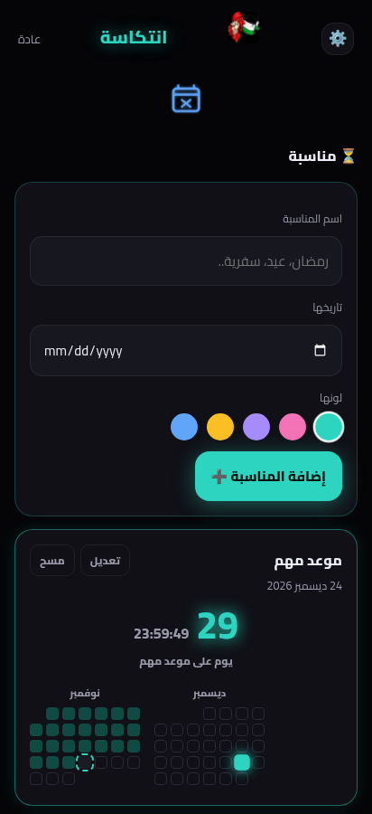
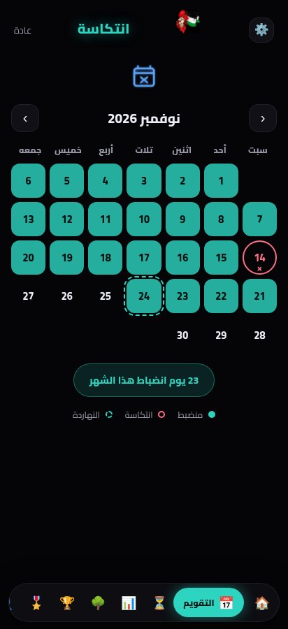
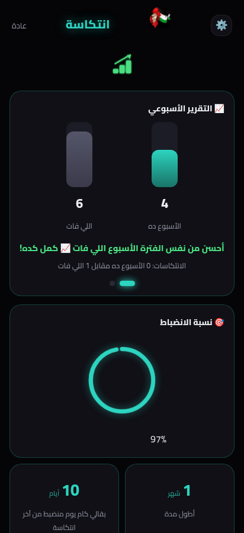
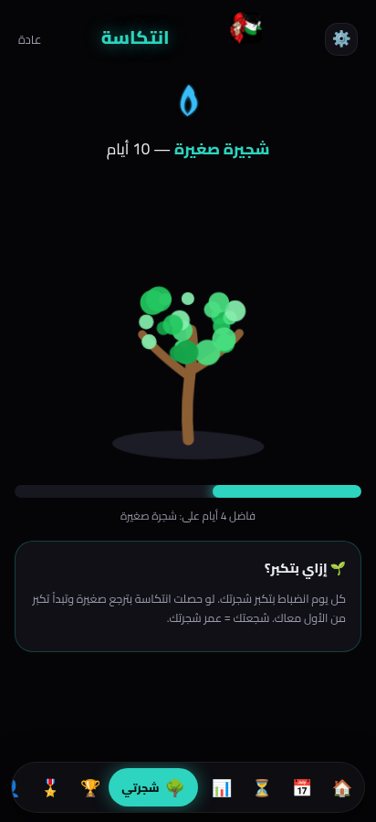
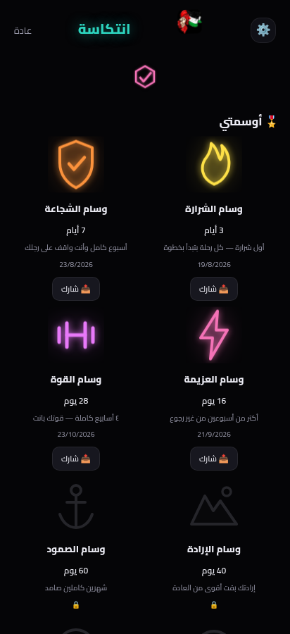
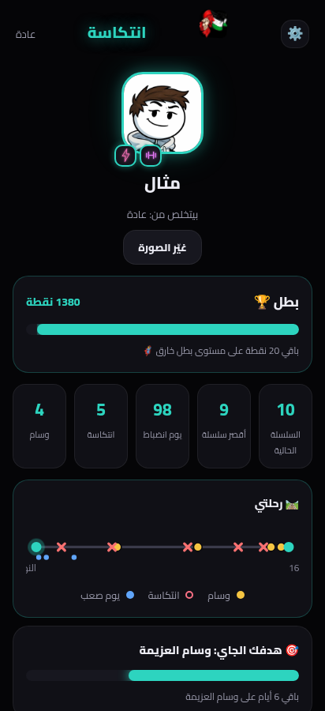
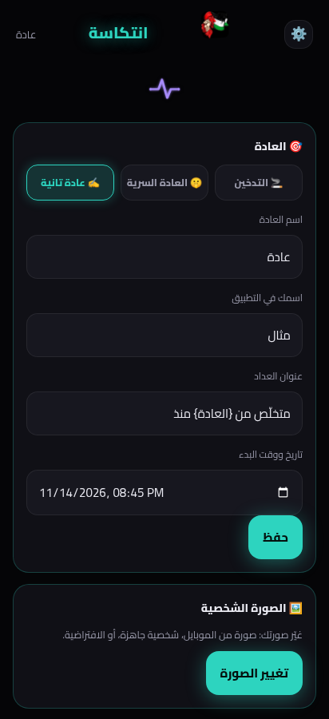

# انتكاسة — Intikasa

تطبيق أندرويد يساعدك تبعد عن عادة وحشة وتتابع تقدمك يوم بيوم: عداد اكتفاء حي، تحديات VIP وأوسمة، مناسبات بعداد تنازلي، شجرة بتكبر معاك، ونصايح دينية ونفسية. بياناتك بتفضل على موبايلك — التطبيق أوفلاين بالكامل، والاستثناء الوحيد اختياري: البحث عن تحديث لو فعّلته.

An Android app to help you quit a bad habit and track your progress day by day: a live clean-time counter, VIP challenges and medals, occasions with live countdowns, a tree that grows with you, and religious & psychological guidance. Your data stays on your phone — fully offline, with one optional exception: checking for updates if you enable it.

---

## لقطات الشاشة — Screenshots

<p align="center">
  <a href="docs/screenshots/full-1-home.png"></a>
  <a href="docs/screenshots/full-2-chal.png"></a>
  <a href="docs/screenshots/full-3-occ.png"></a>
  <a href="docs/screenshots/full-4-calendar.png"></a>
  <a href="docs/screenshots/full-5-stats.png"></a>
</p>
<p align="center">
  <a href="docs/screenshots/full-6-tree.png"></a>
  <a href="docs/screenshots/full-7-ach.png"></a>
  <a href="docs/screenshots/full-8-profile.png"></a>
  <a href="docs/screenshots/full-9-settings.png"></a>
</p>

<p align="center"><i>الصور ببيانات تجريبية لأغراض العرض فقط — اضغط على أي لقطة لعرض الصفحة كاملة.<br/>Screenshots show demo data for illustration only — click any shot to view the full page.</i></p>

---

## المميزات — Features

### العداد — The Counter
- عداد اكتفاء حي بالثواني والدقائق والساعات والأيام، بيتحسب من التوقيت المخزن كل ثانية.
- Live clean-time counter (seconds → days), recomputed from the stored timestamp every tick.
- ٣ ستايلات للعداد (حبوب، تعبئة مائلة، حلقة دائرية) وتقدر تبدل بينهم بالسحب.
- 3 counter styles (pills, slanted fill, circular ring) with swipe switching.

### تحديات VIP — VIP Challenges
- ١٠ تحديات بأسماء وأوسمة خاصة، تحدي واحد نشط في نفس الوقت، وحلقة تقدم وخط بيملى كل ما تقرب.
- 10 named challenges with custom medals, one active at a time, progress ring and fill bar.
- لو انتكست، التحدي الحالي بيتصفّر ويبدأ من الأول — وأوسمتك المكتسبة بتفضل معاك دايمًا.
- A relapse resets only the current challenge; earned medals stay forever.
- بالإضافة للتحديات القديمة بأوسمتها النيون، زي ما هي.
- The original challenges with their neon medals remain, unchanged.
- تحديات تلقائية (٤٥ يوم، شهرين = ٦٠ يوم، ٣ شهور = ٩٠ يوم) بتشتغل لوحدها من أول يوم في سلسلتك الحالية، من غير زر بدء، بتتحسب بالأيام المتواصلة من غير انتكاسة.
- Automatic challenges (45 days, 2 months = 60 days, 3 months = 90 days) that run on their own from the start of your current streak, with no start button, counting consecutive days without a relapse.

### المناسبات — Occasions
- مناسبات متعددة باسم ولون، عداد تنازلي حي (أيام وساعات ودقايق وثواني)، وخريطة شهور لكل مناسبة.
- Multiple occasions with name and color, live countdown (days/hours/minutes/seconds), and a month map for each.
- ودجت للشاشة الرئيسية بتختار فيه أي مناسبة تظهر.
- A home-screen widget with a per-instance occasion picker.

### الإنجازات والشجرة — Achievements & Tree
- ١٧ وسام نيون بأسماء لحد ١٠٠٠ يوم، ومفاجأة باتمان عند تالت وسام.
- 17 named neon medals up to 1000 days, with a Batman surprise at the third.
- شجرة بتكبر كل ما تكمل أيام أكتر.
- A tree that grows with your clean days.
- XP = الأيام النضيفة ×١٠ + الأوسمة ×٥٠ + الفوز بالتحدي الأسبوعي ×١٠٠.

### المتابعة — Tracking
- سجل الانضباط: شبكة آخر ٢٦ أسبوع وتقويم شهري بثلاث حالات (يوم نضيف، انتكاسة، يوم صعب) مع تفاصيل اليوم بالضغط، وألوان بتتغير مع الثيم الفاتح والغامق.
- Discipline log: a 26-week grid and a monthly calendar (clean / relapse / hard day) with per-day details, with colors that follow the light and dark themes.
- إحصائيات: أطول وأقصر سلسلة، عدد الانتكاسات وأسبابها، تقرير أسبوعي وشهري.
- Stats: longest/shortest streak, relapse count and reasons, weekly and monthly reports.
- مشاركة صورة بكل إحصائياتك من الإعدادات، وصورة ملخص شهري.
- Shareable stats image and monthly summary image.

### الاقتباسات — Quotes
- كارت اقتباس في الرئيسية، بيظهر فيه اقتباس مختلف مع كل فتحة للتطبيق.
- A quote card on Home that shows a different quote each time the app opens.

### كارت التعافي — Recovery Card
- نصايح ومعلومات عامة عن التعافي على حسب العادة (سجاير / سكر / نوم) من مصادر طبية موثوقة (NHS، Verywell Health، Sleep Foundation)، وتقدر تقفله في أي وقت.
- General recovery guidance per habit (cigarettes / sugar / sleep) from trusted medical sources, dismissible anytime.

### الخصوصية — Privacy
- كل البيانات على موبايلك بس. مفيش حسابات، مفيش تحليلات، مفيش إشعارات، مفيش خدمات في الخلفية.
- All data stays on the phone. No accounts, no analytics, no notifications, no background services.
- قفل PIN اختياري بيسأل عند كل فتح للتطبيق، مع خيار بصمة، وصورة مختلفة على شاشة القفل مع كل فتحة.
- Optional PIN lock on every app open, with biometrics, and a different image on the lock screen each time.
- الاستثناء الوحيد اختياري: البحث عن تحديث — طلب واحد لـGitHub عن رقم آخر نسخة (يدوي افتراضيًا، أو تلقائي يومي/أسبوعي/شهري عند فتح التطبيق). مفيش بيانات عن عادتك أو نسختك الاحتياطية أو استخدامك بتتبعت، بس GitHub بيشوف بيانات الاتصال العادية زي عنوان الـIP.
- The only optional exception: update check — one GitHub request for the latest version number (manual by default, or daily/weekly/monthly on app open). No habit records, backups, or usage data are uploaded; GitHub receives ordinary connection metadata such as your IP address.
- نسخ احتياطي محلي في Downloads بكلمة سر اختيارية (تشفير)، واستعادة.
- Local encrypted-optional backup to Downloads and restore.

### تخصيص — Personalization
- ١٢ أيقونة للتطبيق تختار منهم من الإعدادات، برسمة كبيرة وواضحة على الشاشة الرئيسية.
- 12 launcher icons to pick from in Settings, with large, clear artwork on the home screen.
- ألوان مميزة (Accent) قابلة للتغيير + وضع فاتح، وصورة شخصية مع إطار نيون.
- Accent color picker + light theme, profile avatar with a neon ring.

---

## التقنيات — Tech

- Android WebView + Java shell — واجهة HTML/CSS/JS محلية بالكامل.
- Android WebView + Java shell — fully local HTML/CSS/JS UI.
- مفيش مكتبات خارجية، مفيش إعلانات، مفيش تتبع.
- No external libraries, no ads, no tracking.

## البناء — Build

تحتاج Android SDK وJDK 17. حط مفتاح التوقيع بتاعك في `app/intikasa.keystore` واعمل `keystore.properties` من `keystore.properties.template`، وبعدين:

You need the Android SDK and JDK 17. Place your own signing key at `app/intikasa.keystore` and create `keystore.properties` from `keystore.properties.template`, then:

```bash
gradle assembleRelease
```

مفتاح التوقيع الأصلي والنسخ الاحتياطية منه مع صاحب التطبيق فقط ومش جزء من المستودع.
The original signing key and its backups stay with the app owner only and are not part of this repository.
